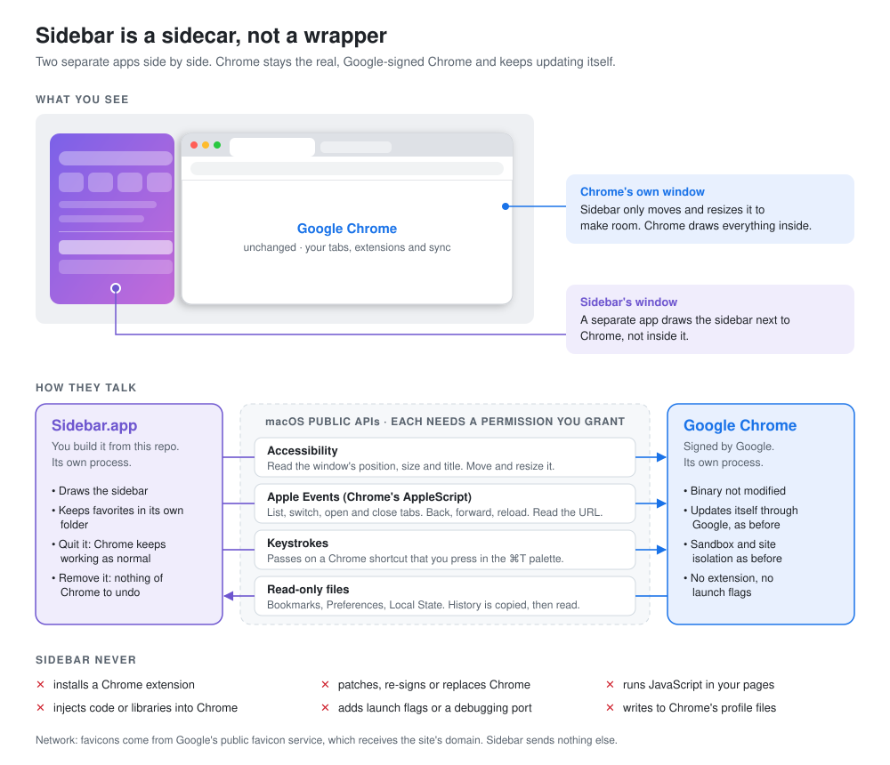

# Sidebar

An Arc-style frame and sidebar for Google Chrome on macOS.

Sidebar is a small menu-bar app. It puts a sidebar panel on the left of your
Chrome window, with:

- your open tabs
- your Chrome bookmarks (synced and local)
- a grid of favorites for each Chrome profile ("space"); drag to add or reorder
- a space switcher: one letter icon per Chrome profile, or a two-finger swipe
- a preview card with the full title and address when the pointer rests on a tab
- pinned tabs for each space, which keep their own URL
- **Clear**, which closes every tab except the active tab, pinned tabs and the tabs of favorites
- auto-archive: tabs that you have not used for 12 hours close, and the ⌘T palette finds them again
- commands in the ⌘T palette: type `>`
- keyboard control of the sidebar: ⌃⌘↓
- drag to reorder tabs (Chrome's tab strip follows)
- a ⌘T palette that searches tabs, bookmarks and history, or opens a URL or a web search
- back, forward and reload buttons, and an address pill that opens the palette

The sidebar color comes from the theme color of the Chrome profile that owns the
window, so each profile gets its own look.



## A sidecar, not a wrapper

Sidebar does not contain, embed or modify Chrome. It is a separate app that
draws its own window next to Chrome's window. You keep using the real Google
Chrome that you installed from Google.

**Chrome stays as it is:**

- The Chrome app is not patched, re-signed, replaced or relaunched by Sidebar.
- Chrome keeps updating itself through Google's updater, on Google's schedule.
- Chrome's sandbox, site isolation, Safe Browsing, extensions, profiles and sync work as before.
- If you quit or delete Sidebar, Chrome works as normal. There is nothing in Chrome to undo.

**How Sidebar talks to Chrome.** Sidebar uses only public macOS interfaces.
macOS asks you for permission first, and you can turn each one off in
System Settings → Privacy & Security.

| Channel | What Sidebar does with it | Permission |
| --- | --- | --- |
| Accessibility | Reads the window's position, size and title. Moves and resizes the window. | Accessibility |
| Apple Events (Chrome's AppleScript) | Lists, switches, opens and closes tabs. Back, forward, reload. Reads the current URL. | Automation → Google Chrome |
| Keystrokes | Passes on a Chrome shortcut that you press while the ⌘T palette is open. | Accessibility |
| Files | Reads `Bookmarks`, `AccountBookmarks`, `Preferences` and `Local State`. Copies `History` and `Favicons` to temporary files to read them, then deletes the copies. | None (your own files) |

**Sidebar never:**

- installs a Chrome extension
- injects code or loads libraries into Chrome
- opens a remote debugging port or adds a flag that changes how Chrome runs
- runs JavaScript in your pages (it does not use Chrome's "Allow JavaScript from Apple Events" setting)
- writes to Chrome's profile files

**Network.** Sidebar makes no network requests. Favicons come from Chrome's own
favicon cache on your Mac. Web searches from the palette open in Chrome.

The code that does all of this is short. See `Sources/Sidebar/ChromeController.swift`,
`Sources/Sidebar/ChromeWindowTracker.swift` and `Sources/SidebarCore`.

## Requirements

- A Mac with Apple silicon (the build script builds for `arm64`)
- macOS 26 (Tahoe) or later
- Google Chrome
- Swift 6.2 or later. The Xcode Command Line Tools are enough; you do not need Xcode.

To install the Command Line Tools:

```sh
xcode-select --install
swift --version   # must show 6.2 or later
```

## Setup

### 1. Get the code

```sh
git clone https://github.com/rossnelson/sidebar.git
cd sidebar
```

### 2. (Recommended) Create a local signing certificate

macOS ties the Accessibility permission to the app's code signature. With an
ad-hoc signature, the signature changes on every build, and macOS asks for the
permission again after each rebuild. A self-signed certificate keeps the
permission across rebuilds. You only do this once.

```sh
cat > cert.cnf <<'CNF'
[req]
distinguished_name = dn
x509_extensions = ext
prompt = no
[dn]
CN = Sidebar Local Signing
[ext]
basicConstraints = critical,CA:false
keyUsage = critical,digitalSignature
extendedKeyUsage = critical,codeSigning
CNF
/usr/bin/openssl req -x509 -newkey rsa:2048 -nodes -days 3650 -config cert.cnf -keyout key.pem -out cert.pem
/usr/bin/openssl pkcs12 -export -inkey key.pem -in cert.pem -name "Sidebar Local Signing" -out id.p12 -passout pass:sidebar
security import id.p12 -k ~/Library/Keychains/login.keychain-db -P sidebar -T /usr/bin/codesign
rm key.pem cert.pem id.p12 cert.cnf
```

Keychain Access shows the certificate as "not trusted". That is expected and
does not matter for local signing.

Skip this step if you only want to try the app once. The build script falls
back to an ad-hoc signature.

### 3. Build

```sh
Scripts/bundle.sh
```

This builds `build/Sidebar.app`. The script signs the app with, in order:

1. the identity in `SIDEBAR_SIGN_IDENTITY`, if you set it
2. the "Sidebar Local Signing" certificate from step 2
3. an ad-hoc signature

Optional: copy the app to Applications.

```sh
cp -R build/Sidebar.app /Applications/
```

### 4. Run and grant permissions

```sh
open build/Sidebar.app      # or /Applications/Sidebar.app
```

Sidebar has no Dock icon. Look for its icon in the menu bar.

On first launch, macOS asks for two permissions:

| Permission | Where | Why |
| --- | --- | --- |
| **Accessibility** | System Settings → Privacy & Security → Accessibility | Follow, move and resize Chrome's window |
| **Automation → Google Chrome** | A prompt the first time Sidebar talks to Chrome | Read, switch, open and close tabs |

After you turn on Accessibility, quit Sidebar from its menu-bar icon and open it again.

### 5. (Optional) Open at login

Add Sidebar in System Settings → General → Login Items → **+**.

## Shortcuts

These shortcuts work only while Chrome is the front app, so other apps keep their own.

| Shortcut | Action |
| --- | --- |
| ⌘T | Open the palette: search tabs, bookmarks and history, or type a URL or search |
| ⇧⌘C | Copy the current tab's URL. You can change this shortcut in Settings. |
| ⌃⌘S | Collapse or expand the sidebar. When collapsed, a thin edge stays visible; move the pointer over it to peek. |

In the palette, Chrome's own ⌘ shortcuts still work. The palette closes and
sends the key to Chrome.

## Settings

Open the menu-bar icon → **Settings…**. To change a shortcut, click its field
and press the new keys. A shortcut must include ⌘, ⌃ or ⌥. Press Esc to cancel.

## Favorites

Each Chrome profile has its own favorites grid, with up to 12 favorites. To add a
favorite, drag a tab onto the grid, or use the tab's context menu. To reorder the
favorites, drag a favorite onto another one. To reorder tabs, drag a tab onto
another tab; the order changes in Chrome too. Open bookmark folders stay open for
each space. Click a favorite to switch to its
open tab, or to open it when no tab matches.

Sidebar saves favorites in
`~/Library/Application Support/Sidebar/favorites-<profile folder>.json`.

## Spaces

Each Chrome profile is a space, with its own colors and favorites. When Chrome
has more than one profile, letter icons at the bottom of the sidebar show each
space. Click an icon, or swipe left or right with two fingers on the sidebar, to
bring that profile's window to the front. Right-click an icon to choose a symbol
or an emoji for that space. When that profile has
no open window, Sidebar asks Chrome to open one with
`open -nb com.google.Chrome --args --profile-directory=<folder>`, the same
request that Chrome's own profile menu makes. The running Chrome opens the
window; nothing else changes.

## Pinned tabs

Right-click a tab and choose **Pin Tab**, or type `> pin` in the palette. Pinned
tabs show above your other tabs and stay when you close their tab: click a dimmed
pin to open it again. When a pinned tab goes to another page, a ↩ button takes it
back to the pinned page. To keep the new page instead, right-click the pin and
choose **Set Pin to Current Page** (or type `> set pin` in the palette); the pin
takes that page's address, title and icon. Drag a pin onto another pin to reorder them.

To rename a pin, double-click it or right-click it and choose **Rename…**. Press
Return to save or Esc to cancel. Clear the name, or choose **Use Page Title**, to
show the page title again.

## Clear and auto-archive

Move the pointer over the space name above your tabs and click **Clear**. Sidebar
closes every tab except the active tab, pinned tabs and the tabs that your
favorites point to.

Sidebar also closes tabs that you have not opened for 12 hours, with the same
exceptions. Change the time, or turn this off, in **Settings… → Tabs**. Sidebar
counts the time from when it started, so it never closes a tab in its first
12 hours.

Sidebar keeps the last 200 closed tabs for each space in
`~/Library/Application Support/Sidebar/archive-<profile folder>.json`. Search for
one in the ⌘T palette (it shows **Archived**) to open it again.

## Keyboard

Press ⌃⌘↓ while Chrome is in front. The sidebar takes the keyboard and selects the
active tab (while collapsed, the sidebar slides out first).

- ↑ and ↓ (or ⌃P and ⌃N, or K and J) move the selection.
- Return opens the selected tab and gives the keyboard back to Chrome.
- Delete closes the selected tab.
- Esc gives the keyboard back to Chrome.

## Palette search

The ⌘T palette also finds your favorites, pinned tabs and other spaces. Type
"temp" to switch to a space named Temporal. Before you type, the palette shows
your open tabs, then the tabs that you closed a short time ago. Sidebar sees a
tab close while it reads Chrome's tabs, and keeps the last 30 until it quits.

## Palette commands

Type `>` in the ⌘T palette to list commands: Clear Tabs, Pin Current Tab, Add
Current Tab to Favorites, Copy URL, Collapse Sidebar, Switch to <space>, Reload
Bookmarks and History, and Open Settings. Type after `>` to filter them.

## Development

```sh
Scripts/test.sh     # unit tests
Scripts/bundle.sh   # release build into build/Sidebar.app
```

`Scripts/test.sh` passes the Swift Testing framework path that SwiftPM does not
find when only the Command Line Tools are installed.

To rebuild and restart:

```sh
pkill -f 'Sidebar.app/Contents/MacOS/Sidebar'; Scripts/bundle.sh && open build/Sidebar.app
```

Code layout:

- `Sources/SidebarCore`: parsing and rules with no UI (bookmarks, history,
  profiles, themes, palette search, window layout, shortcuts). The tests cover this target.
- `Sources/Sidebar`: the AppKit and SwiftUI app (frame, sidebar, palette,
  Chrome window tracking, hotkeys, settings).

## Troubleshooting

**The sidebar does not appear.** Make sure Accessibility is on for Sidebar,
then quit and open Sidebar again. Sidebar attaches only to a normal Chrome
window on the current screen and Space. It does not attach to full-screen windows.

**macOS asks for Accessibility after every rebuild.** The app has an ad-hoc
signature. Create the certificate in step 2 and build again.

**Tabs do not show.** Allow Sidebar to control Chrome in System Settings →
Privacy & Security → Automation.

**Reset the permissions** and get the prompts again:

```sh
tccutil reset Accessibility com.ross.sidebar
tccutil reset AppleEvents com.ross.sidebar
```

## Uninstall

```sh
pkill -f 'Sidebar.app/Contents/MacOS/Sidebar'
rm -rf /Applications/Sidebar.app ~/Library/Application\ Support/Sidebar
defaults delete com.ross.sidebar
security delete-certificate -c "Sidebar Local Signing"   # if you created it
```
